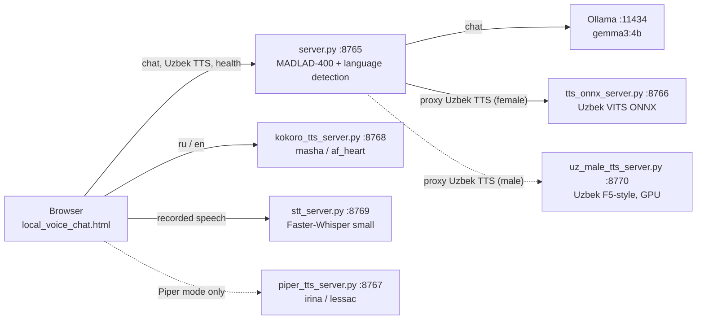

# Local AI Translator / Voice Chat

A local, multilingual (Uzbek / Russian / English) text chat with spoken answers. A browser page
talks to a small Python backend that detects the language, translates the question to English
with MADLAD-400, asks a local Ollama model (Gemma 3 4B) for an answer, translates the answer back,
and the browser then requests speech from one of three local TTS services.

> **Status (2026-10-13):** working prototype on one Windows 11 machine (8 GB RAM, CPU only).
> Not packaged, no automated tests. Model weights and Python environments are not in this
> repository. See [Current status](#current-project-status).

Full documentation: **[docs/INDEX.md](docs/INDEX.md)**.

## Main features

- Text chat in Uzbek, Russian or English; the reply is spoken aloud.
- Local translation (MADLAD-400 3B, CTranslate2 INT8) and local LLM (Ollama `gemma3:4b`; chosen in [docs/LLM_COMPARISON.md](docs/LLM_COMPARISON.md)).
- Voice input: a microphone button records speech and a local Faster-Whisper `small` service
  transcribes it into the message box for review (Russian and English accurate; **Uzbek recognition is poor** — see [docs/STT.md](docs/STT.md)).
  An Uzbek-specialised model was evaluated on real speech and cuts Uzbek errors by ≈ 80 % (WER 1.24 → 0.21); it is not deployed yet — see [docs/STT_EVALUATION.md](docs/STT_EVALUATION.md).
- Local TTS engines routed by language: Uzbek VITS (ONNX), Kokoro (`af_heart`, `masha`);
  Piper (`lessac`, `irina`) and the browser's built-in voice remain as selectable modes.
- Memory-aware Kokoro loading so a large model cannot starve the other services.

## Four separate stages

A chat turn passes through four independent stages. Each can fail on its own, for different reasons:

| Stage | Where | Typical failure |
|---|---|---|
| 1. Language detection | heuristic in `server.py` | wrong language chosen (e.g. Uzbek in Cyrillic is treated as Russian) |
| 2. Translation | MADLAD-400 in `server.py` | poor/truncated translation, out-of-memory at startup |
| 3. Chat generation | Ollama (`gemma3:4b`) | Ollama not running, model not pulled, timeout |
| 4. Speech synthesis | TTS service chosen by the **browser** | TTS service down, model not loaded (HTTP 503), playback blocked |

Optional voice input adds a stage 0 — **speech recognition** (`stt_server.py`) — whose errors
(wrong words, wrong language) are passed on to every later stage; that is why the transcript is shown for review before it is sent.

A good answer with no audio is a stage-4 problem; a spoken but wrong answer is usually stage 1–3.
See [docs/DATA_FLOW.md](docs/DATA_FLOW.md) and [docs/TROUBLESHOOTING.md](docs/TROUBLESHOOTING.md).

## Architecture



Details and sequence diagrams: [docs/ARCHITECTURE.md](docs/ARCHITECTURE.md).

**Current best configuration and the numbers behind every choice:** [docs/CURRENT_SETUP.md](docs/CURRENT_SETUP.md).

## Components and ports

| Component | File | Bind | Port | Python environment |
|---|---|---|---|---|
| Frontend | `local_voice_chat.html` | served by chat backend | 8765 | — |
| Chat backend | `server.py` | `0.0.0.0` (all interfaces) | 8765 | `.venv` |
| Uzbek TTS | `tts_onnx_server.py` | `127.0.0.1` | 8766 | `stt-tts-uz\.venv-tts` |
| Piper TTS | `piper_tts_server.py` | `127.0.0.1` | 8767 | system/any Python + `.venv-piper` (subprocess) |
| Kokoro TTS | `kokoro_tts_server.py` | `127.0.0.1` | 8768 | `.venv-kokoro` |
| STT | `stt_server.py` | `127.0.0.1` | 8769 | `.venv-stt` |
| Uzbek male voice TTS (optional, GPU) | `uz_male_tts_server.py` | `127.0.0.1` | 8770 | `Uzbek_TTS-test\.venv` |
| LLM | Ollama | `127.0.0.1` | 11434 | external application |

## Models and voices

| Language | Voice (default "Kokoro" mode) | If unavailable |
|---|---|---|
| Uzbek (`uz`) | female: `vits_uzbek_finetuned.onnx` via 8766 (default); male: `Uzbek_TTS-test` model via 8770 ("O‘zbekcha ovoz" selector) | error is shown |
| Russian (`ru`) | Kokoro-RU `masha`, male `dima` via 8768 — **only if memory allowed it to load** | the real Kokoro error is shown (no automatic fallback) |
| English (`en`) | Kokoro-82M `af_heart`, male `am_michael` via 8768 | the real Kokoro error is shown |

The page's "Ovoz" selector (Ayol / Erkak) picks the female or male voice for every language.

Russian/English routing depends on the "Ruscha / inglizcha ovoz" selector in the page; only local voices are offered. Piper
(`ru_RU-irina-medium`, `en_US-lessac-medium`; male `ru_RU-dmitri-medium`, `en_US-ryan-medium`; port 8767) is used only when its own mode is selected.
See [docs/MODELS_AND_VOICES.md](docs/MODELS_AND_VOICES.md).

Speech recognition: Faster-Whisper `small` (CPU, int8) on port 8769 — [docs/STT.md](docs/STT.md).

## Prerequisites

- Windows 10/11, Windows PowerShell 5.1, Python 3.12 (verified: 3.12.10).
- [Ollama](https://ollama.com) with `gemma3:4b` pulled.
- The four Python environments and all model files, which are **not** part of the source tree
  (≈ 8 GB). See [docs/DEVELOPMENT_SETUP.md](docs/DEVELOPMENT_SETUP.md).
- Enough **commit memory** (RAM + pagefile). On the 8 GB reference machine not everything fits
  at once; read [docs/MEMORY_AND_PERFORMANCE.md](docs/MEMORY_AND_PERFORMANCE.md) first.

## Quick start

Each service runs in its own PowerShell window, started from `C:\local-ai-translator`:

```powershell
Set-Location C:\local-ai-translator
.\stt-tts-uz\.venv-tts\Scripts\python.exe .\tts_onnx_server.py     # window 1, port 8766
.\.venv-piper\Scripts\python.exe .\piper_tts_server.py              # window 2, port 8767
.\.venv\Scripts\python.exe .\server.py                              # window 3, port 8765
.\.venv-kokoro\Scripts\python.exe .\kokoro_tts_server.py            # window 4, port 8768
.\.venv-stt\Scripts\python.exe .\stt_server.py                      # window 5, port 8769 (voice input)
.\Uzbek_TTS-test\.venv\Scripts\python.exe .\uz_male_tts_server.py   # window 6, port 8770 (optional Uzbek male voice, GPU)
```

Piper (window 2) is optional. On the 8 GB reference machine chat + STT + Kokoro do **not** fit in
memory together — decide which you need ([docs/STT.md](docs/STT.md#memory)).

Then open <http://localhost:8765>. Full procedure, health checks and shutdown:
[docs/WINDOWS_RUNBOOK.md](docs/WINDOWS_RUNBOOK.md).

## Testing

There is no automated test suite. Manual health checks and an end-to-end smoke test are in
[docs/TESTING.md](docs/TESTING.md), together with the recorded results of the tests run on 2026-10-13.

## Hardware and expected performance

This section helps you predict how the system will behave on your own machine. **Measured** values
come from the reference PC (October 2026, details in [docs/MEMORY_AND_PERFORMANCE.md](docs/MEMORY_AND_PERFORMANCE.md)
and [docs/STT.md](docs/STT.md)). **Estimated** values for the second machine are extrapolations from
those measurements and the hardware differences — **nothing has been run on it yet.**

### The two machines

| | Reference PC (measured) | Ubuntu server (estimated) |
|---|---|---|
| OS | Windows 11 Pro | Ubuntu 24.04.4 LTS, kernel 6.14 |
| CPU | Intel i7-9700K — 8 cores / 8 threads, 3.6 GHz | Intel i7-13700 — 16 cores (8P + 8E) / 24 threads |
| RAM | 7.9 GB DDR4 | 64 GB DDR4 |
| Memory limit that matters | Windows **commit limit** ≈ 18–25 GB (RAM + system-managed pagefile) | physical RAM; Linux overcommits, so "commit" is not a hard wall |
| GPU | GTX 1650, 4 GB, **no tensor cores** | RTX 4060, 8 GB, tensor cores |
| GPU driver / CUDA | 617.42 | 550.163.01 / CUDA 12.4 |
| Disk needed by this project | ≈ 10–12 GB (more with CUDA builds of PyTorch) | same |

The estimates assume the project gets the whole GPU and enough free disk on the server (other
workloads that currently run there are expected to be stopped or moved).
| Python | 3.12.10 | 3.12.3 |
| Ollama | 0.40.3 | 0.13.4 |

### Speed per pipeline stage

Times are wall-clock for one short utterance or answer unless stated.

| Stage | Reference PC — measured | Ubuntu server, CPU only — estimate | Ubuntu server, model on RTX 4060 — estimate |
|---|---|---|---|
| Speech-to-text, Whisper `small` int8, 3–5 s of speech | 3.5–5 s (CPU) | 2–3 s | 0.3–0.8 s |
| Speech-to-text on 12 s average FLEURS clips, current model | median 5.9 s (CPU); 1.1 s (GTX 1650) | 3–4 s | 0.5–1 s |
| Same, NavAI Uzbek model (120 clips) | median 3.1–3.3 s (CPU); 0.9 s (GTX 1650, +474 MB VRAM) | 2–2.5 s | 0.3–0.6 s |
| Translation in (MADLAD-400 3B int8) — not used since 2026-10-17 (hybrid pipeline) | 0.8–1.8 s | 0.5–1 s | 0.2–0.5 s |
| Chat answer (Ollama `qwen3:1.7b`, ≤ 100 tokens; until 2026-10-17) | 0.2–1.0 s warm; 4.6–7.3 s when the model was cold | 0.2–0.6 s warm | < 0.5 s |
| Chat answer (Ollama `gemma3:4b`, current) | median 3.1 s (Uzbek), 3.2 s (English, whole request) | 1–2 s | < 1 s |
| Uzbek chat request, text → text (gemma3:4b + MADLAD out, current) | median 6.7 s, p95 12.4 s | 3–4 s | 1–2 s |
| Translation out (MADLAD) | 1.0–6.4 s (longer answers take longer) | 0.6–3.5 s | 0.2–1 s |
| Uzbek TTS (VITS ONNX), ≈ 3 s of audio | 0.5–0.6 s (2026-10-13); 1.0 s median on 4 sentences (2026-10-17) | 0.3–0.4 s | (CPU is enough) |
| Uzbek male voice (Uzbek_TTS, `nfe_step` 8), 3–7 s of audio | 15.9–29.4 s on the GTX 1650 (median 18.2 s); 23–42 s on the CPU | — (use the GPU) | 1–3 s |
| Kokoro English, ≈ 3 s of audio | 0.9–1.2 s | 0.5–0.8 s | 0.1–0.3 s |
| Kokoro Russian `masha`, ≈ 5–7 s of audio | 1.6–2.4 s | 1–1.5 s | 0.2–0.5 s |
| Piper (new process per request) | 3.4–5.4 s | 1.5–3 s | — |
| **Spoken question → start of spoken answer** | **≈ 10–20 s** | **≈ 5–10 s** | **≈ 2–4 s** |
| Model load: chat backend / STT / Kokoro EN+RU | ~8–16 s / 1.3–3.4 s / ~19 s | faster (NVMe-dependent) | similar |

### Memory: what fits together

Per-service memory, measured on the reference PC (commit = memory Windows reserves; RSS = memory actually resident):

| Service | Commit (Windows) | RSS (resident) |
|---|---|---|
| Chat backend (`server.py`, MADLAD) | ≈ 9.9 GB | 0.3–2.6 GB |
| Kokoro, English + Russian | ≈ 5.5 GB | ≈ 4.2 GB after load (2.4–3.0 GB later) |
| Kokoro, English only | ≈ 1.8 GB | ≈ 1.4 GB |
| STT (Faster-Whisper small) | 2.6–3.4 GB | 0.4–1.1 GB |
| Uzbek TTS | 0.4–0.7 GB | 0.1–0.3 GB |
| Ollama with `qwen3:1.7b` (until 2026-10-17) | — | ≈ 1.4 GB |
| Ollama with `gemma3:4b` (current) | — | ≈ 3.3 GB (1.6 GB of it in VRAM on the GTX 1650) |
| Uzbek male voice TTS | — | 0.68 GB VRAM loaded, 1.94 GB peak |
| **Everything together** | **≈ 20 GB** | **≈ 9–11 GB** |

| Configuration | Reference PC, 8 GB (measured) | 16 GB RAM (estimate) | Ubuntu server, 64 GB (estimate) |
|---|---|---|---|
| Chat + Uzbek TTS + STT | fits (≈ 0.7–1.2 GB commit left) | fits | fits easily |
| Chat + Uzbek TTS + Kokoro | English voice only; Russian refused for memory | fits | fits easily |
| Chat + STT + Kokoro (full system) | **does not fit** | fits on Linux; on Windows needs a pagefile ≥ 8 GB | fits with > 30 GB to spare |
| Two STT models (NavAI Uzbek + small for ru/en) | not with chat running | fits | fits easily |
| NavAI **medium** STT (not measured) | not realistic next to chat | likely fits | fits; GPU recommended for speed |

### GPU memory budget (RTX 4060, 8 GB) — estimates

| Model on GPU | VRAM |
|---|---|
| STT small / NavAI small (int8_float16) | ≈ 0.5 GB (measured +472 MB on the GTX 1650) |
| STT medium | ≈ 1.5–2 GB |
| Ollama `gemma3:4b` (current) | ≈ 3.5–4 GB |
| Uzbek male voice TTS | ≈ 2 GB (measured peak 1.94 GB on the GTX 1650) |
| Ollama `qwen3:1.7b` (previous) | ≈ 1.5–2 GB |
| MADLAD-400 3B int8 | ≈ 3–3.5 GB |
| Kokoro (PyTorch, EN + RU) | ≈ 1–1.5 GB |

Suggested split on an 8 GB card: STT + MADLAD + Ollama on the GPU (≈ 5–7 GB), Kokoro and the
Uzbek TTS on the CPU (estimated 0.3–1.5 s per answer on the i7-13700, see the speed table). With ≈ 1–3 GB of VRAM
left, a larger Uzbek STT model (NavAI medium) or Kokoro on the GPU can be tried instead.
If other GPU programs run at the same time, move models back to the CPU until they fit.

### Notes for planning your own setup

- **RAM is the first bottleneck, GPU the second.** 8 GB runs only part of the system; 16 GB runs all of it on Linux (Windows needs a larger pagefile); 32 GB+ leaves room for larger models.
- **Windows counts "commit", not resident memory.** CTranslate2 models (MADLAD, Whisper) commit 3–5× their file size, so Windows runs out long before Task Manager shows full RAM.
- **GTX-class cards without tensor cores help, but modestly.** RTX cards (tensor cores) give much larger speed-ups for Whisper, MADLAD and the LLM.
- **Disk:** about 10–12 GB for environments and models (more with CUDA builds of PyTorch).
- **CUDA:** the GPU tests here used CUDA 12 runtime wheels (`nvidia-cublas-cu12`, `nvidia-cudnn-cu12`) inside the virtual environment; no system CUDA toolkit (`nvcc`) is needed. Driver 550 / CUDA 12.4 should work with them but has not been tested.
- **Porting to Linux** needs small changes: the Piper interpreter path (`.venv-piper\Scripts\python.exe`), the PowerShell start scripts (use bash or `systemd`), and `device="cuda"` where a GPU is wanted. The memory guards use a Windows API and are skipped automatically on Linux.

## Known limitations

- Russian `masha` needs ≈ 4 GB of free commit to load; on the reference machine it usually does not load while MADLAD is running.
- Uzbek speech recognition with Whisper `small` is not usable (word error rate 0.56–1.00 in tests); Russian and English are accurate. STT has only been tested with synthetic speech, not a real microphone.
- Chat, STT and Kokoro cannot all be loaded at once on the reference machine.
- For typed text, language detection is a keyword heuristic (the page's language selector only matters for spoken input and the test-voice button).
- The page calls Kokoro, Piper and STT at `http://127.0.0.1:…`, so voices and voice input only work in a browser on the same machine.
- Translations are capped at 128 decoded tokens; LLM answers at 100 tokens.
- No authentication; the chat backend listens on all network interfaces.

Complete list: [docs/KNOWN_ISSUES.md](docs/KNOWN_ISSUES.md).

## Privacy and local processing

Inference for all four stages runs on the local machine: none of the Python services calls an
external API at request time (source-code confirmed), and the Kokoro server forces Hugging Face
offline mode. This is **not** the same as "fully offline":

- Models, Python packages and Ollama models must be downloaded once from the internet.
- Ollama is a separate application whose own network behaviour (update checks, telemetry) has not been audited here.
- The chat backend binds to `0.0.0.0` without authentication, so other devices on the LAN can reach it.

See [docs/SECURITY.md](docs/SECURITY.md).

## Licensing overview

The project's own code is under the **MIT License** ([LICENSE](LICENSE)). That license covers only
the files in this repository. Third-party models, voices and libraries carry their own terms
([docs/LICENSING.md](docs/LICENSING.md)); notably the Kokoro-RU weights and voices are OpenRAIL and
must be reviewed before any commercial use or redistribution, and some dependencies are GPL-licensed.

## Current project status

| Area | Status |
|---|---|
| Chat pipeline (detect → translate → LLM → translate) | working, manually tested 2026-10-13 |
| Uzbek TTS, Piper TTS, Kokoro English | working, manually tested 2026-10-13 |
| Kokoro Russian `masha` | works when loaded; blocked by memory on the reference machine while chat is running |
| Voice input (STT) | Russian/English working with synthetic test speech (2026-10-14); Uzbek poor; real microphone not yet verified |
| Automated tests, packaging, CI | none |
| Repository license | MIT (own code only) |

See [docs/ROADMAP.md](docs/ROADMAP.md) and [CHANGELOG.md](CHANGELOG.md).

## Repository layout

```
server.py, tts_onnx_server.py, piper_tts_server.py, kokoro_tts_server.py   services
stt_server.py                                                              speech-to-text service
local_voice_chat.html                                                      frontend
start_tts.ps1, start_kokoro_tts.ps1, start_stt.ps1                         start scripts
docs/                                                                      documentation (start at docs/INDEX.md)
docs/requirements/                                                         pip freeze snapshot per environment
KOKORO_TTS.md, README.txt                                                  earlier notes (Uzbek / legacy), superseded by docs/
```

Everything else in the directory (virtual environments, model folders, WAV files, logs, backups,
experiment scripts, three nested third-party git repositories) is local-only material; see
[docs/PROJECT_OVERVIEW.md](docs/PROJECT_OVERVIEW.md).
