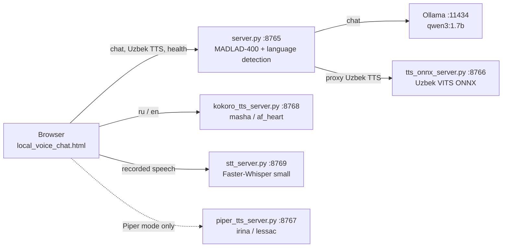

# Local AI Translator / Voice Chat

A local, multilingual (Uzbek / Russian / English) text chat with spoken answers. A browser page
talks to a small Python backend that detects the language, translates the question to English
with MADLAD-400, asks a local Ollama model (Qwen3) for an answer, translates the answer back,
and the browser then requests speech from one of three local TTS services.

> **Status (2026-10-13):** working prototype on one Windows 11 machine (8 GB RAM, CPU only).
> Not packaged, no automated tests. Model weights and Python environments are not in this
> repository. See [Current status](#current-project-status).

Full documentation: **[docs/INDEX.md](docs/INDEX.md)**.

## Main features

- Text chat in Uzbek, Russian or English; the reply is spoken aloud.
- Local translation (MADLAD-400 3B, CTranslate2 INT8) and local LLM (Ollama `qwen3:1.7b`).
- Voice input: a microphone button records speech and a local Faster-Whisper `small` service
  transcribes it into the message box for review (Russian and English accurate; **Uzbek recognition is poor** — see [docs/STT.md](docs/STT.md)).
- Local TTS engines routed by language: Uzbek VITS (ONNX), Kokoro (`af_heart`, `masha`);
  Piper (`lessac`, `irina`) and the browser's built-in voice remain as selectable modes.
- Memory-aware Kokoro loading so a large model cannot starve the other services.

## Four separate stages

A chat turn passes through four independent stages. Each can fail on its own, for different reasons:

| Stage | Where | Typical failure |
|---|---|---|
| 1. Language detection | heuristic in `server.py` | wrong language chosen (e.g. Uzbek in Cyrillic is treated as Russian) |
| 2. Translation | MADLAD-400 in `server.py` | poor/truncated translation, out-of-memory at startup |
| 3. Chat generation | Ollama (`qwen3:1.7b`) | Ollama not running, model not pulled, timeout |
| 4. Speech synthesis | TTS service chosen by the **browser** | TTS service down, model not loaded (HTTP 503), playback blocked |

Optional voice input adds a stage 0 — **speech recognition** (`stt_server.py`) — whose errors
(wrong words, wrong language) are passed on to every later stage; that is why the transcript is shown for review before it is sent.

A good answer with no audio is a stage-4 problem; a spoken but wrong answer is usually stage 1–3.
See [docs/DATA_FLOW.md](docs/DATA_FLOW.md) and [docs/TROUBLESHOOTING.md](docs/TROUBLESHOOTING.md).

## Architecture



Details and sequence diagrams: [docs/ARCHITECTURE.md](docs/ARCHITECTURE.md).

## Components and ports

| Component | File | Bind | Port | Python environment |
|---|---|---|---|---|
| Frontend | `local_voice_chat.html` | served by chat backend | 8765 | — |
| Chat backend | `server.py` | `0.0.0.0` (all interfaces) | 8765 | `.venv` |
| Uzbek TTS | `tts_onnx_server.py` | `127.0.0.1` | 8766 | `stt-tts-uz\.venv-tts` |
| Piper TTS | `piper_tts_server.py` | `127.0.0.1` | 8767 | system/any Python + `.venv-piper` (subprocess) |
| Kokoro TTS | `kokoro_tts_server.py` | `127.0.0.1` | 8768 | `.venv-kokoro` |
| STT | `stt_server.py` | `127.0.0.1` | 8769 | `.venv-stt` |
| LLM | Ollama | `127.0.0.1` | 11434 | external application |

## Models and voices

| Language | Voice (default "Kokoro" mode) | If unavailable |
|---|---|---|
| Uzbek (`uz`) | `vits_uzbek_finetuned.onnx` via 8766 | error is shown |
| Russian (`ru`) | Kokoro-RU `masha` via 8768 — **only if memory allowed it to load** | the real Kokoro error is shown (no automatic fallback) |
| English (`en`) | Kokoro-82M `af_heart` via 8768 | the real Kokoro error is shown |

Routing depends on the "Ovoz tizimi" (voice system) selector in the page. Piper
(`ru_RU-irina-medium`, `en_US-lessac-medium`, port 8767) is used only when its own mode is selected.
See [docs/MODELS_AND_VOICES.md](docs/MODELS_AND_VOICES.md).

Speech recognition: Faster-Whisper `small` (CPU, int8) on port 8769 — [docs/STT.md](docs/STT.md).

## Prerequisites

- Windows 10/11, Windows PowerShell 5.1, Python 3.12 (verified: 3.12.10).
- [Ollama](https://ollama.com) with `qwen3:1.7b` pulled.
- The four Python environments and all model files, which are **not** part of the source tree
  (≈ 8 GB). See [docs/DEVELOPMENT_SETUP.md](docs/DEVELOPMENT_SETUP.md).
- Enough **commit memory** (RAM + pagefile). On the 8 GB reference machine not everything fits
  at once; read [docs/MEMORY_AND_PERFORMANCE.md](docs/MEMORY_AND_PERFORMANCE.md) first.

## Quick start

Each service runs in its own PowerShell window, started from `C:\local-ai-translator`:

```powershell
Set-Location C:\local-ai-translator
.\stt-tts-uz\.venv-tts\Scripts\python.exe .\tts_onnx_server.py     # window 1, port 8766
.\.venv-piper\Scripts\python.exe .\piper_tts_server.py              # window 2, port 8767
.\.venv\Scripts\python.exe .\server.py                              # window 3, port 8765
.\.venv-kokoro\Scripts\python.exe .\kokoro_tts_server.py            # window 4, port 8768
.\.venv-stt\Scripts\python.exe .\stt_server.py                      # window 5, port 8769 (voice input)
```

Piper (window 2) is optional. On the 8 GB reference machine chat + STT + Kokoro do **not** fit in
memory together — decide which you need ([docs/STT.md](docs/STT.md#memory)).

Then open <http://localhost:8765>. Full procedure, health checks and shutdown:
[docs/WINDOWS_RUNBOOK.md](docs/WINDOWS_RUNBOOK.md).

## Testing

There is no automated test suite. Manual health checks and an end-to-end smoke test are in
[docs/TESTING.md](docs/TESTING.md), together with the recorded results of the tests run on 2026-10-13.

## Known limitations

- Russian `masha` needs ≈ 4 GB of free commit to load; on the reference machine it usually does not load while MADLAD is running.
- Uzbek speech recognition with Whisper `small` is not usable (word error rate 0.56–1.00 in tests); Russian and English are accurate. STT has only been tested with synthetic speech, not a real microphone.
- Chat, STT and Kokoro cannot all be loaded at once on the reference machine.
- For typed text, language detection is a keyword heuristic (the page's language selector only matters for spoken input and the test-voice button).
- The page calls Kokoro, Piper and STT at `http://127.0.0.1:…`, so voices and voice input only work in a browser on the same machine.
- Translations are capped at 128 decoded tokens; LLM answers at 100 tokens.
- No authentication; the chat backend listens on all network interfaces.

Complete list: [docs/KNOWN_ISSUES.md](docs/KNOWN_ISSUES.md).

## Privacy and local processing

Inference for all four stages runs on the local machine: none of the Python services calls an
external API at request time (source-code confirmed), and the Kokoro server forces Hugging Face
offline mode. This is **not** the same as "fully offline":

- Models, Python packages and Ollama models must be downloaded once from the internet.
- Ollama is a separate application whose own network behaviour (update checks, telemetry) has not been audited here.
- "Browser voice" mode uses the browser's speech synthesis, which in some browsers sends text to an online service.
- The chat backend binds to `0.0.0.0` without authentication, so other devices on the LAN can reach it.

See [docs/SECURITY.md](docs/SECURITY.md).

## Licensing overview

The project's own code is under the **MIT License** ([LICENSE](LICENSE)). That license covers only
the files in this repository. Third-party models, voices and libraries carry their own terms
([docs/LICENSING.md](docs/LICENSING.md)); notably the Kokoro-RU weights and voices are OpenRAIL and
must be reviewed before any commercial use or redistribution, and some dependencies are GPL-licensed.

## Current project status

| Area | Status |
|---|---|
| Chat pipeline (detect → translate → LLM → translate) | working, manually tested 2026-10-13 |
| Uzbek TTS, Piper TTS, Kokoro English | working, manually tested 2026-10-13 |
| Kokoro Russian `masha` | works when loaded; blocked by memory on the reference machine while chat is running |
| Voice input (STT) | Russian/English working with synthetic test speech (2026-10-14); Uzbek poor; real microphone not yet verified |
| Automated tests, packaging, CI | none |
| Repository license | MIT (own code only) |

See [docs/ROADMAP.md](docs/ROADMAP.md) and [CHANGELOG.md](CHANGELOG.md).

## Repository layout

```
server.py, tts_onnx_server.py, piper_tts_server.py, kokoro_tts_server.py   services
stt_server.py                                                              speech-to-text service
local_voice_chat.html                                                      frontend
start_tts.ps1, start_kokoro_tts.ps1, start_stt.ps1                         start scripts
docs/                                                                      documentation (start at docs/INDEX.md)
docs/requirements/                                                         pip freeze snapshot per environment
KOKORO_TTS.md, README.txt                                                  earlier notes (Uzbek / legacy), superseded by docs/
```

Everything else in the directory (virtual environments, model folders, WAV files, logs, backups,
experiment scripts, three nested third-party git repositories) is local-only material; see
[docs/PROJECT_OVERVIEW.md](docs/PROJECT_OVERVIEW.md).
