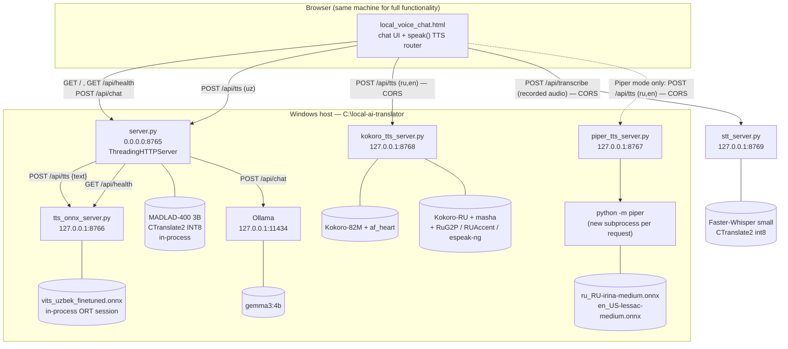
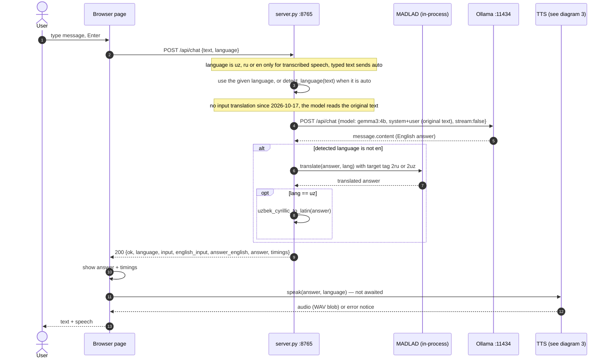
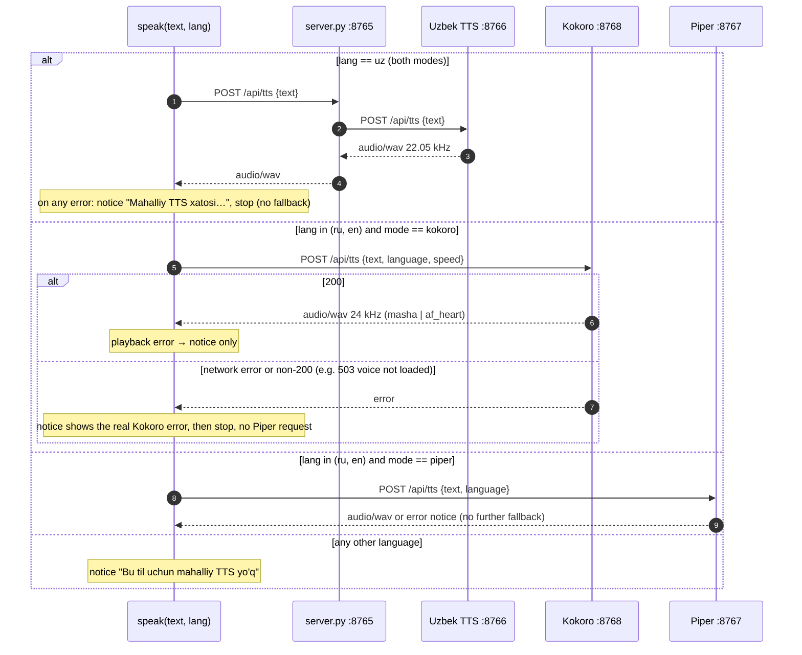
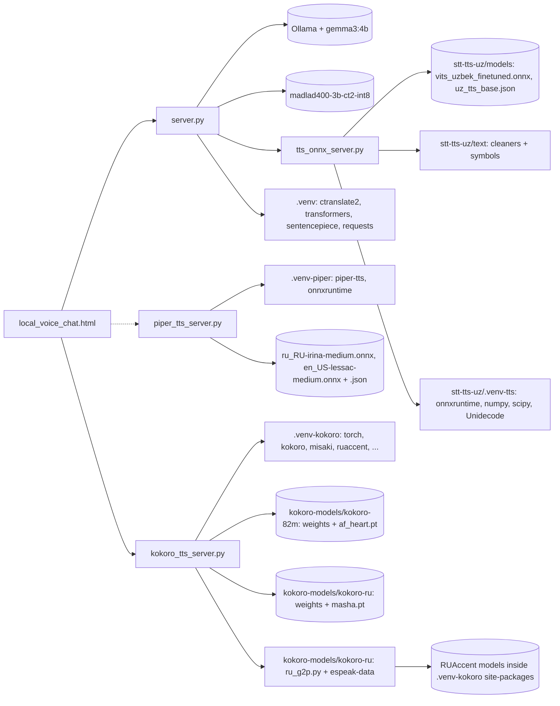

# Architecture

- **Last verified:** 2026-10-14 (STT, language hand-over and the removal of the Piper fallback added and tested that day) · **Status:** `SOURCE-CODE CONFIRMED` (all diagrams traced from the current source); other runtime behaviour `HISTORICAL TEST RESULT` (2026-10-13)
- **Related source:** `server.py`, `tts_onnx_server.py`, `piper_tts_server.py`, `kokoro_tts_server.py`, `local_voice_chat.html`
- **Related:** [DATA_FLOW.md](DATA_FLOW.md), [API_REFERENCE.md](API_REFERENCE.md), [CONFIGURATION.md](CONFIGURATION.md)

## 1. System architecture

Key structural facts (`SOURCE-CODE CONFIRMED`):

- All four Python services are plain `http.server.ThreadingHTTPServer` programs — no web framework.
- The **browser**, not the backend, decides which TTS engine speaks. The backend only proxies Uzbek TTS.
- Kokoro and Piper are called by the browser directly at hard-coded `http://127.0.0.1:8768` / `:8767`
  (cross-origin; both servers send `Access-Control-Allow-Origin: *`). The Uzbek service has no CORS
  headers and is reached only through the same-origin proxy `POST /api/tts` on 8765.
- Voice input is also browser-driven: the page records audio, sends it to `stt_server.py` (8769),
  puts the transcript into the message box and, when the user submits, passes the recognised
  language to `/api/chat`. Details and measurements: [STT.md](STT.md).
- `server.py` knows nothing about Piper, Kokoro or STT. Its `/api/health` reports only itself and the Uzbek TTS.
- There is no shared state, queue, database or session between services. Each chat request is stateless.

## 2. Normal chat request

Errors: an Ollama connection/HTTP failure becomes `502`; any other exception becomes `500`; the page
shows `Xatolik: <error>` as an assistant bubble. Translation and LLM steps are synchronous inside
one HTTP request; MADLAD calls are serialized by `translation_lock`.

## 3. TTS language routing and fallback

Implemented in `speak(text, lang)` in `local_voice_chat.html`. `lang` is the language **returned by
the backend** (`data.language`), not the selector value. `mode` is the "Ovoz tizimi" selector
(`local` | `browser` | `piper` | `kokoro`; `kokoro` is pre-selected).

Routing table for the default `kokoro` mode:

| `lang` | Engine | On failure |
|---|---|---|
| `uz` | Uzbek ONNX via 8765→8766 | error notice |
| `ru` | Kokoro `masha` (8768) | error notice with the real reason (e.g. the memory error) |
| `en` | Kokoro `af_heart` (8768) | error notice with the real reason |

There is **no automatic fallback** between engines. Until 2026-10-14 Kokoro mode fell back to
Piper; that was removed on the owner's request so that a missing voice is never masked by a
different one. Piper speaks only in `piper` mode. Since 2026-10-17 the page offers only the local voices
(modes `kokoro` and `piper`); the browser voice (`speechSynthesis`) and the Uzbek-only `local` mode were removed.

## 4. Component dependencies

Start-up dependencies (who must be up for whom):

| Service | Needs at start-up | Needs at request time |
|---|---|---|
| `server.py` | MADLAD folder; enough commit memory | Ollama for `/api/chat`; Uzbek TTS for `/api/tts` |
| `tts_onnx_server.py` | model + config + `stt-tts-uz/text` | nothing |
| `piper_tts_server.py` | nothing (does not check models until a request) | `.venv-piper` Python, model + `.json` |
| `kokoro_tts_server.py` | model files, voicepacks with matching SHA256, free commit per language | nothing |
| `stt_server.py` | `stt-models\faster-whisper-small\`, free commit | nothing |
| Ollama | — | `gemma3:4b` pulled |

No service refuses to start because another service is down.

## 5. Port and process map

| Port | Bind address | Process (command line) | Notes |
|---|---|---|---|
| 8765 | `0.0.0.0` | `.venv\Scripts\python.exe .\server.py` | reachable from the LAN; no auth |
| 8766 | `127.0.0.1` | `stt-tts-uz\.venv-tts\Scripts\python.exe .\tts_onnx_server.py` | loopback only |
| 8767 | `127.0.0.1` | `.venv-piper\Scripts\python.exe .\piper_tts_server.py` | spawns `python -m piper` per request |
| 8768 | `127.0.0.1` | `.venv-kokoro\Scripts\python.exe [-X utf8] .\kokoro_tts_server.py` | re-launches itself with `-X utf8` if needed |
| 8769 | `127.0.0.1` | `.venv-stt\Scripts\python.exe .\stt_server.py` | Faster-Whisper `small`; ≈ 2.6 GB commit |
| 11434 | `127.0.0.1` | `ollama.exe serve` (child of `ollama app.exe`) | `VERIFIED` listening 2026-10-13, Ollama 0.40.3 |

**Each venv-launched service appears as two `python.exe` processes** (`VERIFIED` earlier on
2026-10-13): the venv launcher `…\Scripts\python.exe` (a few MB) and its child, the base
interpreter `…\Python312\python.exe`, which owns the listening socket and the memory. The PID
reported by `Get-NetTCPConnection` is the child. The Kokoro server adds one more level when it is
started without `-X utf8`, because it re-launches itself via `subprocess`.

## 6. Service design summaries

### 6.1 Chat backend — `server.py`

- Loads the MADLAD tokenizer (`AutoTokenizer`, `local_files_only=True`, `use_fast=False`) and a
  `ctranslate2.Translator` (`device="cpu"`, `compute_type="int8"`, `inter_threads=1`,
  `intra_threads=4`) **at import time**, before the HTTP server binds.
- `detect_language`: any character in U+0400–U+04FF → `ru`; else, after stripping apostrophes, any
  word in `UZ_WORDS` (≈45 words) or the substrings `oʻ` / `gʻ` → `uz`; else `en`.
- `translate(text, target)`: prompt `<2{target}> {text}`, greedy (`beam_size=1`),
  `max_decoding_length=128`, guarded by a global lock.
- `run_chat`: detect → Ollama `gemma3:4b` reads the original text and answers in English → (MADLAD translates
  the answer to uz/ru) → (Uzbek Cyrillic→Latin). Until 2026-10-17 the input was first translated to English with
  MADLAD and the model was `qwen3:1.7b` ([LLM_COMPARISON.md](LLM_COMPARISON.md)).
  `requested_language` is used when it is `uz`, `ru` or `en` (the page sends this only for
  transcribed speech); any other value, including `auto`, means "detect from the text".
- `uzbek_cyrillic_to_latin`: character map (including `ў қ ғ ҳ`) plus two word fixes
  (`kitobxona→kutubxona`, `qaerda→qayerda`). Applied only to Uzbek answers.
- Timeouts: Ollama 180 s, Uzbek TTS proxy 120 s, TTS health probe 1.5 s.
- Failure modes: see [API_REFERENCE.md](API_REFERENCE.md#chat-backend--serverpy-port-8765).

### 6.2 Uzbek TTS — `tts_onnx_server.py`

- Loads one `onnxruntime.InferenceSession` (CPU provider) at import and keeps it.
- Pipeline: drop characters not in the model's symbol table → `text_to_sequence` with
  `uzbek_cleaners` → intersperse blanks (`add_blank: true`) → ONNX inputs `x`, `x_lengths`,
  `noise_scale=0.667`, `noise_scale_w=0.8`, `length_scale=1.0` → clip → 16-bit PCM WAV via `scipy`.
- No lock around `SESSION.run`; no CORS headers; no queue limit.
- Contains an unused line `from email.mime import text`, immediately shadowed by `from text import …`.

### 6.3 Piper TTS — `piper_tts_server.py`

- The server itself uses only the standard library. For every request it writes the text to a
  temp file and runs `<.venv-piper python> -m piper -m <model> -c <model>.json -i input.txt -f output.wav`
  with a 120 s timeout, then returns the WAV bytes.
- The model is therefore **reloaded on every request** (observed 3.4–5.4 s for one short sentence).
- Every error, including bad input, is returned as HTTP `422`.

### 6.4 Kokoro TTS — `kokoro_tts_server.py`

- Start-up: re-exec in UTF-8 mode if needed → set `HF_HUB_OFFLINE=1`, `TRANSFORMERS_OFFLINE=1` →
  bind the socket → load models in a background thread (English first, then Russian).
- Per language before loading: enabled in `KOKORO_LANGS`? free commit ≥ threshold? files present?
  voicepack SHA256 matches? Any failure marks that language not ready and records the error;
  the other language is unaffected.
- English: `KModel` + `KPipeline(lang_code="a")` (misaki G2P with espeak fallback), voice tensor from `af_heart.pt`.
- Russian: `RuG2P` from the model repository's unmodified `ru_g2p.py` (RUAccent stress/ё/homographs →
  orthoepic respelling → espeak-ng with the repository's acute-aware `espeak-data` → vowel reduction)
  → `KModel` with `masha.pt`; the server splits text into sentences and keeps each phoneme string ≤ 510.
- Inference is serialized by `INFER_LOCK`; at most 1 running + 4 waiting requests, further ones get `503`.
- Details: [MODELS_AND_VOICES.md](MODELS_AND_VOICES.md), [MEMORY_AND_PERFORMANCE.md](MEMORY_AND_PERFORMANCE.md),
  [adr/0003-memory-aware-kokoro-loading.md](adr/0003-memory-aware-kokoro-loading.md).

### 6.5 STT — `stt_server.py`

- Binds the port, then loads `WhisperModel("stt-models/faster-whisper-small", device="cpu", compute_type="int8")` once in a background thread; `/api/health` answers during loading.
- Per request: decode with PyAV → Whisper language detection → map to `uz`/`ru`/`en` (confident `ru`/`en`, otherwise `uz`) → transcribe with the VAD filter, never translate.
- One transcription at a time (lock), at most 2 waiting; a free-commit check before loading, like Kokoro.
- Full description, measurements and limitations: [STT.md](STT.md).

## 7. What must not be changed casually

| Item | Why |
|---|---|
| Ports 8765–8768 | Hard-coded in several places: `server.py` (8766), the HTML (8767, 8768), each server |
| JSON field names `text`, `language` | Shared contract between page, proxy and TTS servers |
| Kokoro load order (English before Russian) | Russian G2P switches the global espeak data path; English must initialise first |
| `kokoro-models\kokoro-ru\ru_g2p.py` and `espeak-data\` | Used unmodified from upstream; stock espeak data silently ignores stress marks |
| `REQUIRED_FREE_MB` thresholds | Lowering them can crash the other services (see incident in [MEMORY_AND_PERFORMANCE.md](MEMORY_AND_PERFORMANCE.md)) |
| `stt-tts-uz\text\cleaners.py` | Carries a local patch that removes the `phonemizer` dependency |
| Voicepack SHA256 constants | They are the guarantee that `masha` / `af_heart` are really the files loaded |
