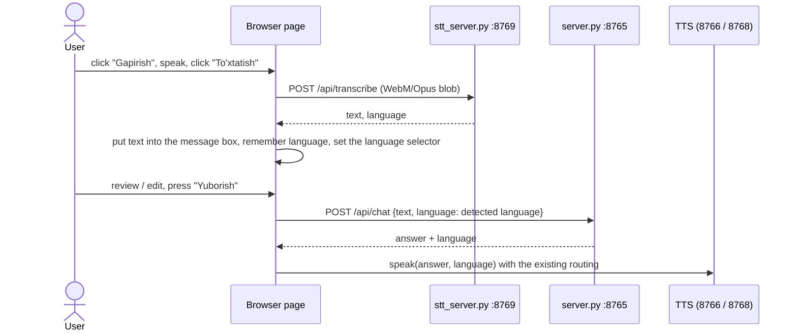

# Speech-to-text (STT)

- **Last verified:** 2026-10-14 (tests run on the night of 2026-10-13/14)
- **Status:** implementation `SOURCE-CODE CONFIRMED`; every number below is a measurement from this machine (`VERIFIED` at that time) unless marked otherwise
- **Related source:** `stt_server.py`, `start_stt.ps1`, `local_voice_chat.html` (microphone button), `server.py` (`run_chat` language handling)
- **Related:** [ARCHITECTURE.md](ARCHITECTURE.md), [API_REFERENCE.md](API_REFERENCE.md#stt--stt_serverpy-port-8769), [WINDOWS_RUNBOOK.md](WINDOWS_RUNBOOK.md), [MEMORY_AND_PERFORMANCE.md](MEMORY_AND_PERFORMANCE.md)

## Summary

| Question | Answer |
|---|---|
| Does it work? | **Russian and English: yes**, accurately. **Uzbek: technically yes, practically no** — the `small` model's Uzbek output is mostly wrong words. |
| Model | Faster-Whisper `small` (CTranslate2), CPU, `int8`, loaded once at start |
| Port | `127.0.0.1:8769` |
| Memory | ≈ 2.6 GB commit, ≈ 0.4 GB RSS |
| Speed | ≈ 3.5–5 s for utterances of 1–16 s |
| Fits next to chat **and** Kokoro on this machine? | **No.** Pick two of {chat, STT, Kokoro} — see [Memory](#memory) |
| Tested with real human speech / a real microphone? | **No.** Only synthetic (TTS-generated) speech and a simulated microphone stream. See [What was not tested](#what-was-not-tested) |

## Why Faster-Whisper `small`

It was specified by the project owner as the starting configuration: one multilingual model with
built-in language identification, small enough to try on an 8 GB CPU-only machine, running on
CTranslate2 (already used for MADLAD). No comparison with other STT models was made. The measured
result is that `small` is a good choice for Russian and English and an inadequate one for Uzbek.
Per the task rules, the model was **not** silently replaced; alternatives are listed under [Next steps](#next-steps-proposed).

## Installation (as executed)

```powershell
Set-Location C:\local-ai-translator
py -3.12 -m venv .venv-stt
.\.venv-stt\Scripts\python.exe -m pip install --upgrade pip
.\.venv-stt\Scripts\python.exe -m pip install faster-whisper psutil
.\.venv-stt\Scripts\python.exe -m pip install "av<17"
.\.venv-stt\Scripts\python.exe -c "import faster_whisper; print(faster_whisper.download_model('small', output_dir=r'C:\local-ai-translator\stt-models\faster-whisper-small'))"
```

The third `pip` line is required: `faster-whisper 1.2.1` calls `av.open(..., metadata_errors=...)`,
which PyAV 19 (installed by default) no longer accepts — every upload failed with `TypeError` until
PyAV was pinned to 16.1.0. (pip left two harmless leftover folders, `~v` and `~v.libs`, in
`.venv-stt\Lib\site-packages`; they can be deleted by hand.)

| Item | Value |
|---|---|
| Environment | `.venv-stt`, CPython 3.12.10, 351 MB; nothing was changed in `.venv` or `.venv-kokoro` |
| Packages | `faster-whisper 1.2.1`, `ctranslate2 4.8.3`, `av 16.1.0`, `onnxruntime 1.31.0` (Silero VAD), `tokenizers 0.23.3`, `huggingface_hub 2.2.0`, `numpy 2.5.4`, `psutil 7.2.2` — full list in [requirements/stt-venv.freeze.txt](requirements/stt-venv.freeze.txt) |
| Model source | <https://huggingface.co/Systran/faster-whisper-small> @ `536b0662742c02347bc0e980a01041f333bce120` (license: MIT per repository metadata) |
| Model location | `stt-models\faster-whisper-small\` (464 MB): `model.bin` 483 546 902 bytes, `config.json`, `tokenizer.json`, `vocabulary.txt` |
| `model.bin` SHA256 | `3e305921506d8872816023e4c273e75d2419fb89b24da97b4fe7bce14170d671` — equal to the Hugging Face LFS object id |
| Network at runtime | none: the server sets `HF_HUB_OFFLINE=1` and loads with `local_files_only=True` |

`stt-models\` and `stt-test-audio\` are excluded from git.

## Start / stop

```powershell
Set-Location C:\local-ai-translator
.\.venv-stt\Scripts\python.exe .\stt_server.py        # or: .\start_stt.ps1
```

Wait for `[STT] model tayyor`. Stop with `Ctrl+C`, or by port:

```powershell
Stop-Process -Id (Get-NetTCPConnection -LocalPort 8769 -State Listen).OwningProcess
```

Environment variables: `STT_THREADS` (default 4; 8 was measured and gave no speed-up),
`STT_SKIP_MEMCHECK=1` (skip the 1200 MB free-commit check before loading).

Health check result recorded after start:

```json
{"ok": true, "service": "Local Faster-Whisper STT", "ready": true, "loading": false, "error": null,
 "model": "small", "model_path": "C:\\local-ai-translator\\stt-models\\faster-whisper-small",
 "device": "cpu", "compute_type": "int8", "cpu_threads": 4,
 "supported_languages": ["uz", "ru", "en"], "load_seconds": 1.46,
 "memory_mb": {"rss": 380, "commit": 2587}, "free_commit_mb": 6141}
```

While loading, the same endpoint answered with `"ready": false, "loading": true` (observed).
If the model cannot be loaded, `error` contains the reason and `/api/transcribe` returns `503` with it; no other model is tried.

## How a request is processed

1. Body = raw audio bytes, or `multipart/form-data` with one file part.
2. Decode with PyAV (bundled FFmpeg) to 16 kHz mono float. No system FFmpeg is needed.
3. Reject: shorter than 0.3 s, longer than 180 s, or digitally silent.
4. `detect_language` (Whisper) on the first 30 s → probabilities for all Whisper languages.
5. Choose the chat language (rule below), unless `?language=uz|ru|en` forces one.
6. `transcribe` with `task="transcribe"` (never translate), `beam_size=5`, Silero VAD filter on,
   `condition_on_previous_text=False`, plus per-language options.
7. Empty result → `422` "Nutq aniqlanmadi".

One transcription runs at a time (lock); at most 2 more may wait, further requests get `503`.

### Supported audio formats (tested)

| Format | Result |
|---|---|
| WebM/Opus produced by the browser's `MediaRecorder` | ✔ |
| WebM/Opus produced by FFmpeg | ✔ |
| WAV (PCM 16-bit, 16/22.05/24 kHz) | ✔ |
| OGG/Vorbis | ✔ |
| MP3 | ✔ |
| `multipart/form-data` upload of a WebM file | ✔ |
| random bytes | `422` "Audio faylni o'qib bo'lmadi (InvalidDataError)" |

Other FFmpeg-decodable formats probably work but were not tested.

## Language detection behaviour

Whisper's detector is used, but its raw answer is **not** used directly, because for Uzbek speech
`small` almost never answers "uz":

| Clip (Uzbek speech) | Raw detection | P(uz) | P(ru) | P(en) |
|---|---|---|---|---|
| `uz_req.wav` | `hy` 0.57 | 0.003 | 0.042 | 0.014 |
| `uz_long.wav` | `hy` 0.23 | 0.017 | 0.036 | 0.040 |
| `uz_onnx.wav` | `az` 0.58 | 0.0003 | 0.049 | 0.057 |
| `test_ayol.wav` | `az` 0.75 | 0.012 | 0.003 | 0.0005 |
| `uz_short.wav` ("Rahmat.") | `en` 0.35 | 0.000 | 0.020 | 0.346 |

Russian and English clips were detected with probability 0.94–0.998. Letting Whisper transcribe in
the raw detected language is harmful: one Uzbek clip detected as Armenian took **117 s** and produced Armenian-script garbage.

Rule implemented in `stt_server.py`:

- if the larger of P(ru), P(en) is **≥ 0.5** → that language;
- otherwise → **`uz`** (the only remaining supported language).

Consequences: the service only ever returns `uz`, `ru` or `en`; speech in any other language is
labelled `uz`; a very unclear Russian/English utterance could also fall to `uz`. The response
carries `detected_language` (raw) and `language_probabilities` so the decision can be inspected,
and `language_probability` is near 0 whenever `uz` was chosen by this rule (the page then shows "taxminiy" instead of a percentage).

Uzbek-only decoding options (`LANGUAGE_OPTIONS["uz"]`), each from a measurement:

| Option | Why |
|---|---|
| `initial_prompt` (an Uzbek Latin-script sentence) | WER 1.00 → 0.56 and 0.93 → 0.79 on two reference clips; pushes spelling towards Latin Uzbek |
| `no_speech_threshold=None` | Whisper's own no-speech check discarded real Uzbek speech (no-speech probability 0.61–0.76): three clips returned nothing at all. Silence and noise are still rejected by the VAD filter. |
| `log_prob_threshold=None`, `temperature=(0.0, 0.4)` | low confidence triggered repeated temperature retries: 11–40 s for clips of 0.6–3 s. With the override: 4.3–4.7 s. |

## Access through `server.py` (phones, HTTPS tunnels) — added 2026-10-14

The page no longer calls `http://127.0.0.1:8769` directly. It posts to **`/api/transcribe` on its
own origin**; `server.py` forwards body, `Content-Type` and `?language=` to the STT server and
returns its JSON unchanged. Health: `/api/stt/health`. This is what makes voice input work when the
page is opened through a Cloudflare tunnel (e.g. on an iPhone): the phone cannot reach the PC's `127.0.0.1`.

iPhone Safari records `audio/mp4` (AAC); the page accepts that type and the STT server decodes it.

Tested 2026-10-14, locally and via `https://<name>.trycloudflare.com` (quick tunnel to `localhost:8765`):
health `200`; Russian/English/Uzbek M4A (AAC), WebM and WAV uploads `200` with the same transcripts
as direct calls (RU/EN exact); multipart and `?language=ru` preserved; empty body `400`, bad file
`422`, silence `422`, bad language `400`; `/api/chat` and Uzbek `/api/tts` unchanged. In the
built-in browser opened on the tunnel URL (secure context), the microphone button recorded a
simulated stream, uploaded 65 KB of WebM/Opus to `/api/transcribe` → `200`, and the transcript was
inserted. **A real iPhone was not available to the tester** — that check is still open.

Through the tunnel, Kokoro (`127.0.0.1:8768`) and Piper (`127.0.0.1:8767`) are still called
directly by the page, so Russian/English **speech output** does not work on the phone; Uzbek TTS does (it is proxied).

## Connection to chat and TTS



Frontend (`local_voice_chat.html`):

- A **🎤 Gapirish** button sits next to **Yuborish**. States: `🎤 Gapirish` (idle) → `⏹ To‘xtatish` (recording, red) → `⏳ Matnga aylantirilmoqda…` (transcribing, disabled) → idle. The status line shows "Yozilmoqda…", "Nutq matnga aylantirilmoqda…", "Transkript tayyor · til: … Matnni tekshirib, «Yuborish»ni bosing." or "STT xatosi: …".
- Recording uses `MediaRecorder` (`audio/webm;codecs=opus` when supported). The transcript is **inserted, not sent**: the user reviews it and presses Yuborish. If the box already contains text, the transcript is appended.
- The detected language is kept in `sttLang` and sent as `language` with the next chat request, then cleared. Clearing the box clears it; changing the "Suhbat tili" selector while a transcript is pending overrides it (useful when Uzbek speech was mislabelled).
- Typed messages are sent with `language: "auto"`, so typed chat behaves exactly as before (text-based detection). The default selector value (`uz`) is never sent on its own.

Backend (`server.py`, one line changed): `run_chat` now uses the requested language when it is
`uz`/`ru`/`en` and falls back to `detect_language(text)` otherwise. This is the same line the file
had before the "auto language" change; previous file kept as `server.py.before_stt.bak`.

TTS: routing is unchanged (`uz` → ONNX 8766, `ru` → Kokoro `masha`, `en` → Kokoro `af_heart`).
One behaviour was changed on request: in **Kokoro mode the page no longer falls back to Piper**. If
Kokoro cannot speak, the real error is shown, e.g. `Kokoro (Masha) TTS xatosi: ru modeli tayyor emas: MemoryError: xotira yetarli emas…`.
The separate "Piper" voice-system option still exists and is untouched; STT adds no Piper dependency.

## Test results

Test audio (`stt-test-audio\`, not in git): the three required sentences, a short and a long
utterance per language, the required sentences mixed with pink noise, plus silence, noise-only, a
0.1 s file and random bytes. **All speech clips are synthetic**: Russian/English from Kokoro
(`masha`, `af_heart`), Uzbek from the project's Uzbek ONNX voice. Existing clips were also used
(`test_ru.wav`, `test_en.wav` from Piper; `stt-tts-uz\audio\test.wav`; `Uzbek_TTS-test\test_data\test_ayol.wav`, origin and reference text unknown).

WER = word error rate after lower-casing and removing punctuation (`ё` = `е`).

### Required sentences

| Language | Audio | Detected | Transcript | WER | Processing |
|---|---|---|---|---|---|
| Russian | 5.14 s | `ru` 0.94 | Привет. Расскажи мне короткую интересную историю. | **0.00** | 3.87–4.15 s |
| English | 3.75 s | `en` 0.996 | Hello, please explain how artificial intelligence works. | **0.00** | 3.70–4.05 s |
| Uzbek | 2.83 s | `uz` (rule; raw `hy` 0.57) | menge bugun ge konu chon qis qayreja tuze pere. | **1.00** (every word wrong; reference: "Salom, menga bugungi kun uchun qisqa reja tuzib ber.") | 4.74 s |

### Other clips

| Clip | Audio | Result | WER | Processing |
|---|---|---|---|---|
| RU short "Спасибо." | 1.60 s | Спасибо! | 0.00 | 3.57 s |
| EN short "Thank you." | 1.43 s | Thank you. | 0.00 | 3.53 s |
| UZ short "Rahmat." | 0.63 s | Ṣa Ṣa. | 1.00 | 4.45 s |
| RU long (4 sentences) | 15.91 s | exact (пошел/пошёл) | 0.00 | 5.00 s |
| EN long (4 sentences) | 12.43 s | exact | 0.00 | 4.81 s |
| UZ long (4 sentences) | 9.37 s | "Bugun khavadi de yaxshi, man e'r talap e'r taturdam, wajiske bardam. …" | 0.96 | 6.45–6.70 s |
| RU + pink noise | 5.14 s | exact | 0.00 | 3.87 s |
| EN + pink noise | 3.75 s | exact | 0.00 | 3.71 s |
| UZ + pink noise | 2.83 s | Zawam menga bugun gekun mu chon qas qayreja tuza pier. | ≈ 0.9 | 4.25 s |
| RU/EN as WebM, OGG, MP3 | — | exact | 0.00 | 3.7–3.9 s |
| `kokoro_ru1.wav`, `test_ru.wav` (Piper) | 6.8 s / 3.3 s | exact | 0.00 | 3.9–4.1 s |
| `kokoro_en1.wav`, `test_en.wav` (Piper) | 3.5 s / 2.9 s | exact | 0.00 | 3.8 s |
| `uz_onnx.wav` (ref. "Assalomu alaykum! Xush kelibsiz. Sizga qanday yordam bera olaman?") | 3.41 s | Assalomu alaykum! Bugşu gelipsiz. Sizi gapendi yordam bering olaman. | 0.56 | 2.5 s (model only) |
| `stt-tts-uz\audio\test.wav` (reference in that repo's README) | 19.84 s | mostly wrong | 0.79 | 5.6 s (model only) |
| `test_ayol.wav` (unknown text) | 6.41 s | jizakh kollegilare de infrak zil anikla gichili tourneketler ornatil moxte. | n/a | 4.5 s |
| forced `?language=en` on Russian audio | 5.14 s | "Hello. Tell me a short and interesting story." — forcing the wrong language makes Whisper translate; do not force unless sure | — | 3.73 s |

Empty / invalid input:

| Input | Response |
|---|---|
| 3 s digital silence | `422` Audio jim: ovoz yozilmagan (0.04 s) |
| 3 s noise only | `422` Nutq aniqlanmadi (faqat sukunat yoki shovqin) (1.7 s) |
| 0.1 s file | `422` Audio bo'sh yoki juda qisqa (0.10 s) |
| random bytes | `422` Audio faylni o'qib bo'lmadi (InvalidDataError) |
| empty body | `400` Audio yuborilmadi (bo'sh so'rov) |
| `?language=de` | `400` language: auto, uz, ru yoki en bo'lishi kerak |
| 4 simultaneous requests | 3 × `200` (3.9 s, 7.6 s, 11.5 s — serialized), 1 × `503` STT band |

### Speed

- Model load: **1.3–3.4 s** (five starts: 1.46, 1.35, 2.20, 3.38, 1.32).
- A request costs ≈ 1.7 s for language detection + ≈ 2.1 s for transcription of a short clip, almost independent of clip length up to ≈ 5 s; 16 s of speech took 5.0 s. Short commands therefore feel slower than real time (0.6 s clip → 4.5 s).
- `cpu_threads` 4 → 8: no measurable gain. `beam_size` 5 → 1: ≈ 0.2 s gain, not adopted.

### Memory

Process (`psutil`: commit = private bytes, RSS = working set):

| Moment | Commit | RSS |
|---|---|---|
| after `import faster_whisper` | 295 MB | 52 MB |
| model loaded | 2 587–2 604 MB | 344–381 MB |
| during / after inference | 2 705–2 713 MB | 400–431 MB |
| peak commit (process lifetime) | 2 864 MB | — |

The 2.3 GB jump happens inside `ctranslate2.models.Whisper(...)` itself (measured without
faster-whisper: 19 MB → 2 315 MB commit, 343 MB RSS). It does not depend on thread count or on the
VAD. The cause is not known; the same pattern (commit ≫ RSS, ≫ file size) is seen for MADLAD in
`server.py`. The `REQUIRED_FREE_MB = 1200` guard in `stt_server.py` is lower than this real need and
should be raised to ≈ 2800 (left unchanged pending a decision; noted in [KNOWN_ISSUES.md](KNOWN_ISSUES.md)).

System-wide (free commit / commit limit; the pagefile is system-managed and grew during the tests from 18.9 to 24.1 GB):

| Running together | Free commit after loading | Outcome |
|---|---|---|
| Uzbek TTS only | 8 096 MB | baseline |
| Uzbek TTS + **STT** + **Kokoro (EN + RU)** | 1 119 MB | all loaded; STT inference fine (free commit ≈ 1.0 GB afterwards) |
| **Chat** (`server.py`) + Uzbek TTS + **STT** | 703–1 174 MB | all loaded; **Kokoro then refused both voices** (needs 2200 / 4000 MB) |
| **Chat** + Uzbek TTS + **Kokoro** (no STT) | 1 623 MB | Kokoro English loaded, Russian refused (1 703 MB free, 4 000 needed) |
| Chat + STT + Kokoro | — | **does not fit** on this machine |

Largest consumers when everything was up: `server.py` 9 904 MB commit (2 282 MB RSS), STT 2 483–2 603 MB,
Uzbek TTS 665 MB; outside the project: the Claude desktop app ≈ 1.7 GB, MySQL ≈ 0.6 GB, Defender ≈ 0.4 GB.
No process crashed during these tests; the Kokoro guard refused instead.

### End-to-end in the browser

Run in the Claude desktop app's built-in Chromium browser against the real page, with services
chat + Uzbek TTS + STT (+ Kokoro running but with no voice loaded, for lack of memory).
**The microphone was simulated**: the built-in browser blocks microphone access, so
`getUserMedia` was replaced by a Web Audio stream that plays a test clip. Everything after that is
the real code path — the page's own button handlers, `MediaRecorder` (real WebM/Opus encoding), upload, insertion, chat, TTS.

| Step | English clip | Russian clip | Uzbek clip |
|---|---|---|---|
| Button while recording | `⏹ To‘xtatish [recording]` | same | same |
| Button after stop | `⏳ Matnga aylantirilmoqda… [transcribing]` | same | same |
| Upload | 55 173-byte `audio/webm;codecs=opus` → `200` | 80 883 bytes → `200` | 45 754 bytes → `200` |
| Status line | Transkript tayyor · til: en, ishonch 99% · 3.96s audio, 4.23s | til: ru, ishonch 94% · 5.34s audio, 4s | til: uz · 3.06s audio, 4.3s |
| Text in the message box | Hello, please explain how artificial intelligence works. | Привет! Расскажи мне короткую интересную историю. | Assalom, menga bugun gekun u chon qis qayreja tuze pier. |
| Language selector (was) → now | `uz` → `en` | `uz` → `ru` | `en` → `uz` |
| Sent automatically? | no | no | no |
| Chat request after pressing send | `"language":"en"` → `200` | `"language":"ru"` → `200` | `"language":"uz"` → `200` |
| Answer | English, about AI | Russian story (кошка, скрытый сад…) | Uzbek ("Assalomu alaykum, men yordam berish uchun keldim…") — a reply to garbled input |
| TTS | `503` → `Kokoro (Heart) TTS xatosi: en modeli tayyor emas: MemoryError…` shown; nothing played; no Piper request | `503` → `Kokoro (Masha) TTS xatosi: ru modeli tayyor emas: MemoryError…` shown; no Piper request | Uzbek ONNX played to the end (5.5 s) |

Typed chat and TTS routing after the changes (services: chat + Uzbek TTS + Kokoro with English loaded, STT stopped):

| Typed text | Sent | Answer | TTS |
|---|---|---|---|
| Hello! What is the capital of France? | `language:"auto"` | Paris. | Kokoro `af_heart` played (1.45 s) |
| Привет! Как дела? | `language:"auto"` | Я в порядке, спасибо! | `503`, real Kokoro error shown, no Piper |
| Salom, bugun havo qanday? | `language:"auto"` | Bugun quyoshli, iliq kun. | Uzbek ONNX played (2.3 s) |

Kokoro voices in the browser with both loaded (services: Uzbek TTS + STT + Kokoro EN+RU; chat stopped, page already open): "Test ovozi" → `Kokoro (Masha) ovozi ijro etilmoqda…` → `Tayyor.` and `Kokoro (Heart) ovozi ijro etilmoqda…` → `Tayyor.` (the final status appears only when playback ends).

Chat API with explicit language: `auto`/`en`/`ru`/`uz`/missing all behaved as designed (8 calls, all `200`).

## What was not tested

| Not run | Why |
|---|---|
| **Real human recordings of the three required sentences** | none exist in the project and none could be made in this session |
| **A real microphone** | the built-in browser denies microphone access (`NotAllowedError`); only the error path was observed: `STT xatosi: mikrofonga ruxsat berilmadi yoki mikrofon topilmadi (NotAllowedError).` |
| Real background noise, far-field speech, accents, children's voices | no recordings |
| Firefox / Edge / mobile browsers | not available in the session |
| Speech → spoken Kokoro answer in **one** configuration with chat | chat + STT + Kokoro do not fit in memory |
| Long recordings (> 20 s), many requests over time | not run |

Because Whisper was trained on human speech, results on clean TTS audio may be **better or worse**
than with a real microphone. The Russian/English numbers are probably optimistic for noisy rooms;
the Uzbek numbers may partly reflect the synthetic Uzbek voice — but the language-identification
failure and upstream's published accuracy for small Whisper models on Uzbek point the same way.

**To finish verification, the owner should:** start the services, open <http://localhost:8765> in
their own browser, allow the microphone, and say each of the three sentences once.

## Known limitations

1. **Uzbek recognition is not usable** with `small`: WER 0.56–1.00 on five clips; a one-word command was not recognised at all.
2. Uzbek is chosen by exclusion ("not confidently Russian or English"), so any other language or unclear speech is labelled `uz`.
3. Commit memory ≈ 2.6 GB; chat + STT + Kokoro cannot run together on the reference machine.
4. Fixed ≈ 3.5 s latency even for one word; no streaming or partial results.
5. Forcing the wrong language makes Whisper translate instead of transcribe.
6. Requires PyAV < 17 with faster-whisper 1.2.1.
7. The page calls `http://127.0.0.1:8769` directly: STT works only in a browser on the same machine (same as Kokoro). Browsers allow microphone capture only on `localhost`/HTTPS origins, so opening the page via a LAN IP will also block the microphone.
8. The load-time memory guard (1200 MB) is too low for the measured need.

## Next steps (`PROPOSED`)

- Verify with real speech (above). If Uzbek matters — which this project's purpose suggests — evaluate, as an explicit decision: a Whisper model fine-tuned for Uzbek converted to CTranslate2; the Uzbek ONNX STT referenced by the `stt-tts-uz` repository (its models are not on this machine); or Whisper `medium`/`large-v3` (memory will be several times higher).
- Let the user pin the language before recording (the `?language=` parameter already exists) to skip detection (−1.7 s) and avoid the exclusion rule.
- Find out why CTranslate2 commits ≈ 5× the model size on this machine — it would help MADLAD (9.9 GB) even more.
- Raise `REQUIRED_FREE_MB`; consider an on-demand STT process that exits when idle.
